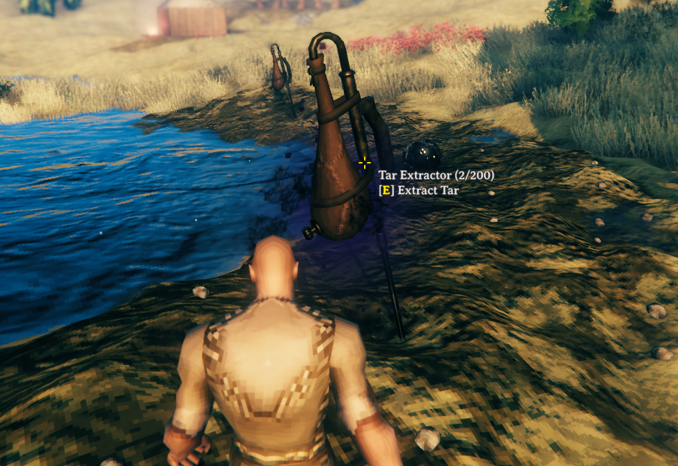

# TarExtractor

Adds a buildable Tar Extractor that passively collects Tar from Plains tar pits.

## How It Works

The Tar Extractor works like the Sap Extractor, but for tar pits instead of Ancient Roots:

- Place it inside a tar pit (it also works on drained pits). Outside a tar pit the placement ghost turns red and a message tells you why.
- It produces **1 Tar every 60 seconds** and holds up to **200 Tar**.
- Interact with it to collect the stored Tar. It drops next to the extractor.
- Progress is saved on the piece, so it keeps filling up while you are away.

## Building It

Find it in the Hammer's **Crafting** tab. It needs a Workbench nearby and the same materials as the Sap Extractor:

| Material         | Amount |
| ---------------- | ------ |
| Yggdrasil wood   | 10     |
| Black metal      | 5      |
| Dvergr extractor | 1      |

## Configuration

Settings are in the BepInEx config file `javidahmed64592.tarextractor.cfg`.
Settings marked "(Synced with server)" use the server's values when the server has the mod installed.

## Compatibility

- The Tar Extractor is built from the vanilla Sap Extractor, so mods that change the Sap Extractor may change it too.
- It looks for the vanilla tar pit locations, so world generation mods that rename or replace them may stop it being placed.
- This mod has not been tested with a gamepad, only with keyboard and mouse.

## Uninstalling

Tar Extractors disappear from the world when the mod is removed, along with any Tar stored in them.
Collect the Tar and deconstruct them first to get their materials back.

## License

This project is licensed under the MIT License - see the [LICENSE](https://github.com/javidahmed64592/Valheim-TarExtractor/blob/main/LICENSE) file for details.
